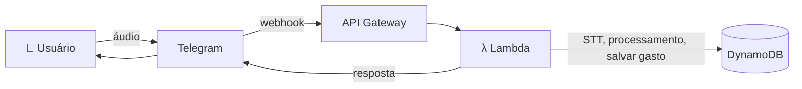

<div align="center">

# 💰 Money Savior

**Bot do Telegram para controle de finanças pessoais, construído em Go e pensado para rodar serverless na AWS.**


[Funcionalidades](#-funcionalidades) •
[Arquitetura](#-arquitetura) •
[Começando](#-começando) •
[Deploy](#-deploy) •
[Roadmap](#-roadmap) •
[Contribuindo](#-contribuindo)

</div>

---

> [!IMPORTANT]
> 🎙️ **Em breve:** registre seus gastos enviando um **áudio** no Telegram. Veja o [Roadmap](#-roadmap).

## 📖 Sobre

O **Money Savior** permite registrar e acompanhar suas despesas conversando com um bot no Telegram, sem precisar abrir planilhas ou aplicativos extras. Os dados ficam armazenados no **Amazon DynamoDB**.

**Status atual:** o foco é colocar o bot no ar na **AWS** e, em seguida, evoluir para o registro de gastos por áudio.

## ✨ Funcionalidades

| Funcionalidade | Status |
| --- | :---: |
| Registrar despesas | ✅ Disponível |
| Consultar saldo | ✅ Disponível |
| Resumo / relatório por categoria | ✅ Disponível |
| Registrar gastos por **áudio** (STT) | 🚧 Próxima atualização |

## 🏗️ Arquitetura

Fluxo planejado para a atualização de áudio (arquitetura serverless):



1. O usuário envia um **áudio** ao bot no Telegram.
2. O Telegram dispara um **webhook** para o **API Gateway**.
3. O API Gateway aciona a **Lambda**, responsável por:
   - **STT** (speech-to-text): transcrever o áudio para texto
   - interpretar a mensagem e **salvar o gasto**
   - aplicar as demais regras de negócio
4. Os dados são persistidos no **DynamoDB**.
5. A Lambda envia a **resposta** ao usuário pelo Telegram.

> O fluxo acima é o planejado e pode mudar durante a implementação.

## 🛠️ Stack

| Camada | Tecnologia |
| --- | --- |
| Linguagem | Go 1.24 |
| Integração com Telegram | [go-telegram-bot-api v5](https://github.com/go-telegram-bot-api/telegram-bot-api) |
| Banco de dados | Amazon DynamoDB ([AWS SDK for Go v2](https://github.com/aws/aws-sdk-go-v2)) |
| Compute *(planejado)* | AWS Lambda + API Gateway |
| STT *(planejado)* | Google Speech-to-Text ou Whisper (a definir, priorizando o tier gratuito) |
| CI/CD | Pipeline de CI para publicar no ambiente |

## 📁 Estrutura do projeto

```
.
├── app/        # Código-fonte da aplicação
├── go.mod      # Módulo e dependências
└── go.sum
```

## 🚀 Começando

### Pré-requisitos

- [Go 1.24+](https://go.dev/dl/)
- Bot criado via [@BotFather](https://t.me/BotFather) (para obter o token)
- Conta AWS com acesso ao DynamoDB e credenciais configuradas (`aws configure` ou variáveis de ambiente)

### Instalação

```bash
git clone https://github.com/AmrmDev/money-savior-telegram-bot.git
cd money-savior-telegram-bot
go mod download
```

### Configuração

<!-- TODO: confirmar os nomes reais das variáveis lidas no código. -->

| Variável | Descrição |
| --- | --- |
| `TELEGRAM_BOT_TOKEN` | Token do bot gerado pelo BotFather |
| `AWS_REGION` | Região AWS do DynamoDB |
| `AWS_ACCESS_KEY_ID` | Credencial AWS |
| `AWS_SECRET_ACCESS_KEY` | Credencial AWS |

```bash
export TELEGRAM_BOT_TOKEN="seu-token"
export AWS_REGION="us-east-1"
```

### Executando

<!-- TODO: confirmar o comando de execução. -->

```bash
go run ./app
```

## 🗄️ Modelo de dados

<!-- TODO: nome da tabela, chave de partição/ordenação e atributos principais. -->

Os gastos e usuários são persistidos no DynamoDB.

## ☁️ Deploy

O deploy para o ambiente na AWS é automatizado por um **pipeline de CI/CD** definido no repositório.

<!-- TODO: indicar o caminho/nome do arquivo de CI (ex.: .github/workflows/...), o gatilho (push na main?) e o que ele faz. -->

## 🗺️ Roadmap

- [x] Registro de despesas
- [x] Consulta de saldo
- [x] Resumo por categoria
- [ ] ☁️ **Deploy na AWS** *(em andamento)*
- [ ] 🎙️ **Registro de gastos por áudio** *(próxima atualização)*
  - [ ] Receber áudio via webhook (API Gateway)
  - [ ] Transcrição (STT) na Lambda
  - [ ] Interpretar texto e salvar o gasto
  - [ ] Responder o usuário no Telegram

## 🤝 Contribuindo

Contribuições são bem-vindas!

1. Faça um fork do projeto
2. Crie uma branch: `git checkout -b feature/minha-feature`
3. Commit: `git commit -m "feat: minha feature"`
4. Push: `git push origin feature/minha-feature`
5. Abra um Pull Request

## 📄 Licença

<!-- TODO: adicionar arquivo LICENSE (ex.: MIT) e referenciar aqui. -->

## 👤 Autor

Feito por [AmrmDev](https://github.com/AmrmDev).
